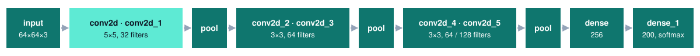
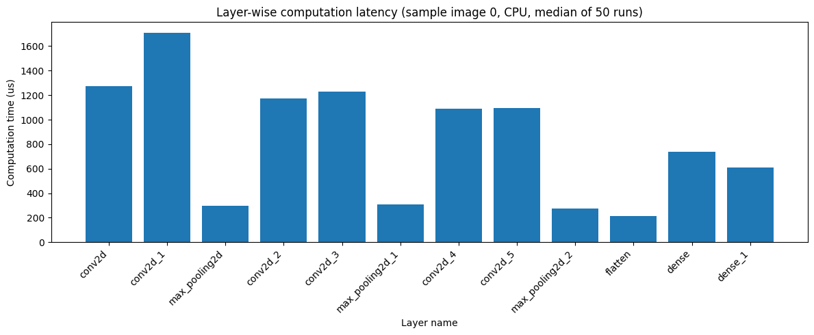

<div align="center">


Iowa State University · CprE 487/587 · Lab 1 · Team 06

[Why](#why) · [Where this lab fits](#where-this-lab-fits) · [Results](#results) · [Reproduce](#reproduce) · [What changed in the re-run](#what-changed-in-the-re-run) · [Limitations](#limitations-and-next-steps)

</div>

---

> **Where it stands — Experiments complete, report in progress**  
> Inference, profiling and training of a 12-layer TinyImageNet CNN in TensorFlow, re-run from a clean template.  
> The model is right one time in four. Convolution takes most of the compute, and one layer, `conv2d_1`, takes most of that.

| Top-1 · provided model | Convolution share of compute | Batch 200 vs. online | Retrained from scratch |
| :---: | :---: | :---: | :---: |
| **24.30%** | **76% online · 94% batched** | **47× throughput** | **24–25% in 8 epochs** |

| | |
|---|---|
| Period | Original team submission September 2026 · individual re-run October 7, 2026 |
| Team | 2 — Zach Dixon, Jongwoo Kim |
| This repository | My re-run of the whole lab from the course template, checked step by step against the handout. The earlier team notebook is kept in `previous_lab_data/` |
| Stack | Python 3.9, TensorFlow/Keras 2.16.2, TensorFlow Datasets, TensorBoard profiler, Jupyter |
| Deliverables | [Notebook (PDF)](submission/lab1_notebook_06.pdf) · [Notebook (.ipynb)](submission/lab1_notebook_06.ipynb) · [Exported binaries](submission/lab1_binaries_06) · report in progress |
| Later labs | [Lab 2 — C++ framework](https://github.com/devjwk/487lab2), [Lab 3 — MAC units](https://github.com/devjwk/487lab3), [Lab 4 — quantization](https://github.com/devjwk/cpre487lab4), [Lab 5 — hardware integration](https://github.com/devjwk/cpre487lab5) |

## Why

Labs 2–5 reimplement this network in C++, quantize it, and move its arithmetic onto an FPGA. Before any of that, this lab answers three questions about the reference model in TensorFlow: how accurate is it, which layers cost the most time, and can it be retrained. It also exports the weights and per-layer outputs that the later labs test against.

## Where this lab fits


## The model

Six 5×5 / 3×3 convolutions, three max-pools and two dense layers: 770,216 parameters, 2.94 MB as float32, 131.6 M multiply-accumulates (MACs) per image. Input is a 64 × 64 RGB image stored as `uint8` (12,288 bytes).



## Results

Inference and profiling were measured on a lab CPU, training on an NVIDIA A40-8Q GPU VM.

**Accuracy of the provided model** (10,000 validation images, 200 classes)

| Top-1 | Top-5 | Top-10 |
|---|---|---|
| 24.30% | 49.40% | 61.74% |

**Where the time goes** — per image, from the TensorBoard profiler

| Layer | Online (µs) | Share | Batch 200 (µs) | Share | MACs (M) |
|---|---|---|---|---|---|
| conv2d | 283 | 15.9% | 45.0 | 7.7% | 8.64 |
| **conv2d_1** | **538** | **30.3%** | **310.3** | **53.1%** | **80.28** |
| conv2d_2 | 167 | 9.4% | 62.8 | 10.7% | 12.46 |
| conv2d_3 | 187 | 10.5% | 87.3 | 14.9% | 21.23 |
| conv2d_4 | 90 | 5.1% | 17.3 | 3.0% | 3.69 |
| conv2d_5 | 94 | 5.3% | 27.1 | 4.6% | 4.72 |
| 3 max-pool layers | 198 | 11.1% | 29.8 | 5.1% | 0 |
| dense + dense_1 | 220 | 12.4% | 4.9 | 0.8% | 0.57 |



**Online vs. batch inference** (the same 1,000 validation images)

| Batch size | Latency | Throughput | Per image |
|---|---|---|---|
| 1 (online) | 56.33 s | 17.8 img/s | 56.33 ms |
| 20 | 4.46 s | 224.0 img/s | 4.46 ms |
| 40 | 2.73 s | 366.9 img/s | 2.73 ms |
| 100 | 1.68 s | 594.9 img/s | 1.68 ms |
| 200 | 1.19 s | 841.6 img/s | 1.19 ms |

Of the 56.3 s online run, the model's own operations take 1.78 s. The rest is the fixed cost of calling `model.predict` once per image.

**Training from scratch** (Adam, learning rate 3e-4, early stopping on validation loss)

| Run | Epochs run | Best validation Top-1 | Best validation Top-5 |
|---|---|---|---|
| batch 32, up to 20 epochs | 8 | 24.40% | 48.92% |
| batch 64, up to 20 epochs | 8 | 24.99% | 49.28% |
| batch 128, up to 20 epochs | 12 | 24.82% | 48.92% |
| batch 32, 3 epochs | 3 | 18.93% | 42.96% |
| batch 32, 10 epochs | 10 | 24.41% | 48.98% |
| batch 32, 100 epochs requested | 8 | 23.86% | 49.52% |

One epoch at batch 32 takes 318 s on the CPU and about 15 s on the GPU.

## Takeaways

- **The reference model is weak but not random.** 24.30% Top-1 is 49 times chance (0.5%), and retraining the same architecture lands in the same place, so the limit is the architecture and data, not the provided weights.
- **Optimize convolution, starting with `conv2d_1`.** It holds 61% of the model's MACs and over half of the batched compute time. This is the layer the Lab 3 and Lab 5 MAC hardware targets.
- **Per-call overhead dominates small inputs.** A single-image `model.predict` call costs about 57 ms while the layers need under 2 ms, so batching gives a 47× throughput gain before any layer gets faster.
- **Compute cost tracks MACs only when batched.** Online, `dense` has 1/150 of the MACs of `conv2d_1` but a third of its time; at batch 200 it nearly disappears.
- **More epochs stop helping after about 8.** Training accuracy keeps rising while validation loss turns up, and early stopping ends a 100-epoch request at epoch 8.

## Reproduce

The environment is the one in section 3.2 of the handout (`CprE487_587_Lab1.pdf`): a Python 3.9 virtual environment `lab1_venv` with TensorFlow 2.16.2. The dataset downloads on the first run.

The notebook `CprE_487_587_Lab1_Template.ipynb` is run in two sessions.

| Sections | Device | How |
|---|---|---|
| Dataset, inference, exploration, profiling | CPU | Set `ENABLE_GPU = False` in the first cell and run the cells down to the end of the Tensorboard section |
| Training | GPU | Set `ENABLE_GPU = True`, then run only the first cell, the dataset cell, `# Setup for profiling`, and the Training cells |

```bash
# GPU session (from the lab machine)
ssh -L 5050:localhost:5050 <netid>@cpre587-f26-06.ece.iastate.edu
cd <lab1 directory> && source lab1_venv/bin/activate
export LD_LIBRARY_PATH=$LD_LIBRARY_PATH:/usr/local/cuda/lib64
jupyter notebook --no-browser --port 5050
```

The layer-wise latency cell holds values read from TensorBoard (Profile tab, tool `framework_op_stats`). If the profiling cells are re-run, those values must be read again.

## Exported binaries

The later labs load these files directly, so the layouts are fixed.

| Files | Content | Format |
|---|---|---|
| `img_data/image_{0,1,2}.bin` | Three validation images (pomegranate, miniskirt, German shepherd) | raw `uint8`, (H, W, C), 12,288 bytes |
| `img_data/test_input_{0,1,2}/<layer>_output.bin` | Output of all 12 layers for each image | raw `float32`, (1, H, W, C) or (1, N) |
| `model_data/<layer>_weights.bin`, `_bias.bin` | Weights and biases of the 8 trainable layers | raw `float32`, Keras layout: conv (H, W, in, out), dense (in, out) |

The notebook checks that the weight files hold exactly 770,216 values and that the class predicted from each exported final-layer output matches the inference result.

## What changed in the re-run

`previous_lab_data/ANALYSIS_KR.md` lists the problems found in the first attempt. The re-run fixes them.

| First attempt | Re-run |
|---|---|
| Training collapsed in some runs (loss fixed at ln 200 = 5.298, accuracy 0.50%) | All six runs train normally with a lower learning rate; a warning prints if a run collapses |
| `EarlyStopping` was created but never passed to `fit()`, so 100 epochs ran for 22 minutes | Callback is used; the 100-epoch request stops at epoch 8 |
| Saved models for 3 / 10 / 100 epochs overwrote one file | Epoch count is part of the file name |
| Inference timing was taken with the GPU enabled | Measured on CPU, as the template asks |
| No warm-up and no explicit `batch_size`, so batch throughput jumped from 604 to 2,295 img/s | Warm-up before timing and `batch_size` passed to `predict`; throughput rises smoothly from 224 to 842 img/s |
| Layer times were typed in from an unidentified run | Values come from named profiler runs, and their sums match the per-type totals |
| Filter figure split into six separate figures | One row of filters per layer |
| Sample images changed on every run | Taken from the unshuffled validation split, so they are fixed |

## Repository layout

```
CprE_487_587_Lab1_Template.ipynb   the notebook, with outputs
CprE487_587_Lab1.pdf               lab handout
CNN_TinyImageNet.h5                provided model (wnids.txt, words.txt: class labels)
model_data/                        exported weights and biases
submission/                        notebook PDF and .ipynb, exported binaries (report to be added)
previous_lab_data/                 first team notebook and the analysis of its problems
assets/                            README banner and figure
```

`img_data/`, `log_data/` and `train_data/` are generated by the notebook and are not tracked; the copy of `img_data/` that belongs to the submission is in `submission/lab1_binaries_06/`.

## Limitations and next steps

- The report is not finished, so `submission/` does not contain `lab1_report_06.pdf` yet.
- Each training configuration was run once. Differences under one percentage point between batch sizes are within run-to-run variation.
- Because early stopping was active, no run went past epoch 12. What happens at very large epoch counts is inferred from the trend, not measured.
- The notebook was executed in two kernel sessions, so its execution counts are not in one sequence and the first cell shows the GPU session.
- In the notebook PDF, long code lines are cut off at the right edge of the page.
- The optional "Above and Beyond" section was not attempted.
